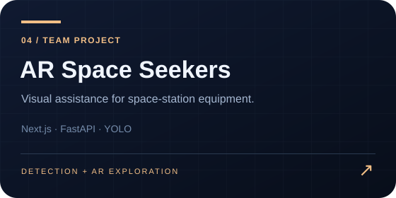
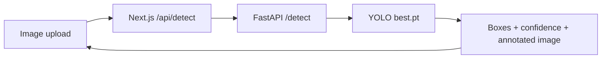

<p align="center"></p>

# AR-Assist · AR_Space_Seekers

A team project exploring computer-vision assistance for identifying **fire extinguishers, toolboxes and oxygen tanks** in space-station imagery.

This repository includes the web implementation and the team's AR concept/demo assets.

[Setup and API guide](docs/DEVELOPMENT.md) · [Model status and limitations](docs/MODEL.md)

## Implementation

The web application uses **Next.js, React and TypeScript** to upload images and display detection results. A Next.js route forwards requests to a **Python FastAPI** backend that loads `public/models/best.pt` with Ultralytics YOLO. Pillow renders annotated images. The frontend uses Tailwind CSS and shadcn/ui components.

The original project notes describe YOLOv8 training on synthetic space-station imagery from Duality AI's Falcon platform. Training data, a reproducible training pipeline and measured mAP results are not included here, so no numeric model-quality claim is made.



## Quick start

```bash
git clone https://github.com/jaskirats01/AR_Space_Seekers.git
cd AR_Space_Seekers
python -m venv .venv
# Activate the virtual environment for your shell.
python -m pip install -r requirements.txt
npm ci
```

From the repository root, run the model backend in one terminal:

```bash
python api/detect.py
```

In a second terminal:

```bash
npm run dev
```

Use the virtual environment in the Python terminal. Open `http://localhost:3000`; the backend defaults to `http://localhost:8000`. Verify `/health` and `/info` directly on the Python server before interpreting detections. See the [development guide](docs/DEVELOPMENT.md) for configuration and troubleshooting.

## Current demo behaviour

The frontend can fall back to fixed mock detections if inference fails. Successful-looking boxes alone do not establish that the model ran. The alternate Python scripts also have simulation behaviour. Use `api/detect.py` and inspect backend health/logs when testing actual inference; see [model status](docs/MODEL.md).

## Demo gallery


- [Application demo](DEMO/App-Demo-Video/App-Demo-Live-Update.mp4)
- [Satellite AR concept demo](DEMO/Satellite-AR/Satellite-AR-Demo.mp4)
- [Web upload workflow recording](DEMO/Website-Demo-Video/Website-Demo-Upload-Function.mp4)

These recordings document the project at the time of capture; the Unity mobile application remains a work in progress.


## Project structure

| Path | Purpose |
|---|---|
| `app/` and `components/` | Next.js UI and server route |
| `api/detect.py` | Model-backed FastAPI entry point |
| `api/real-detect.py`, `api/simple-detect.py` | Alternative experiments with fallback/demo behaviour |
| `lib/pytorch-processor.ts` | Frontend request handling and fallback |
| `public/models/` | Model artifacts |
| `output_results/` | Sample/generated annotated images |
| `test-setup.py`, `test-image-output.py` | Manual diagnostic scripts |

There is no `/web-ai-version/` directory; the web application lives at the repository root.

## Team and status

Created by **Team ARSpaceSeekers** for **BuildWithDelhi 2.0**. Team leader: **Akash Jha**, as credited in the original project documentation. The Unity AR application remains under development.

## Next work

Make demo mode visible, validate class mapping against model metadata, document training provenance and evaluation, add API/UI tests, and address build/type-check errors before treating the application as deployment-ready.
